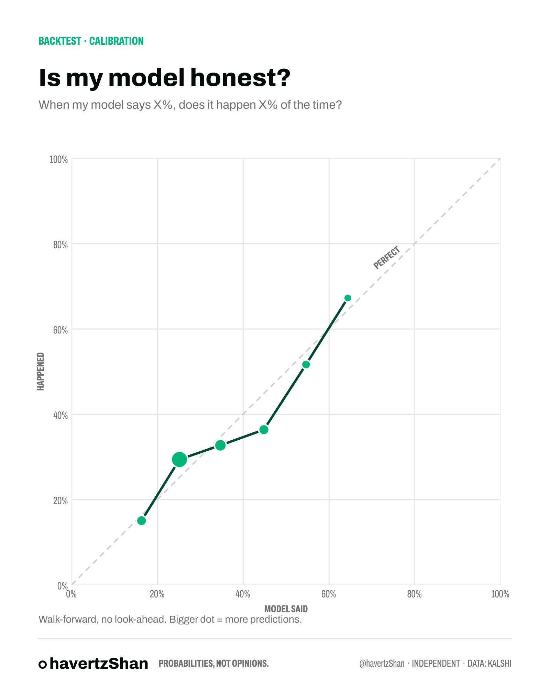

# model-vs-market

My models vs prediction-market prices, scored in public. Every miss stays up.

Season 1: **Premier League vs Kalshi** (`KXEPLGAME` match markets).

## How it works

1. **Model:** [Dixon-Coles (1997)](https://doi.org/10.1111/1467-9876.00065) goals model. Each team gets an attack and defence rating, plus a shared home advantage, a low-score correction (ρ), exponential time decay so recent matches count more, and shrinkage toward a "promoted team" prior for sides with little Premier League data.
2. **Market:** Kalshi bid/ask midpoints for home, draw, and away, normalized to sum to 100% (removes the overround).
3. **Scoring:** multi-class Brier score at kickoff. 0 is perfect, 0.667 is a coin flip, lower is better.

## Premier League Market Index

What does the market think every team is worth right now? Each Kalshi match price is a view on two teams at once. `mvm index` fits one rating per team so a Dixon-Coles model reproduces Kalshi's pre-kickoff prices across the season. Recent prices count more (45-day half-life), and ratings are shrunk toward the results model when a team has few markets. Then:

- **Index** = expected points per game against a league-average opponent (half home, half away)
- **Title / Top 4 / Relegation** = share of 20,000 simulated seasons, starting from the real table

```bash
python -m mvm index          # live: settled + open KXEPLGAME prices
python -m mvm index --demo   # offline: synthetic prices, for testing
python -m mvm titlegap --market "Arsenal=71,Man City=12,Brighton=8,Liverpool=5,Chelsea=4"
                             # Kalshi title market vs title odds implied by Kalshi match prices
```

## Ladders: any "above X" market -> full forecast

Many Kalshi markets are ladders (score >= 85 / >= 90 / >= 95; event before Dec / Jan / Mar).
`mvm ladder` turns one into bucket probabilities, a market-implied expected value, and a consistency
check (a higher threshold can never be more likely than a lower one).

```bash
python -m mvm ladder --above "80=97,85=91,90=74,95=41,97=12" --title "GTA 6: what Kalshi expects from critics" \
  --unit "Metacritic score" --floor 70 --ceil 100
```

## Backtest (walk-forward, no look-ahead)

The model is refit before every matchday using only earlier matches.

| Season | Model Brier | Base rates | Coin flip | Accuracy |
|---|---|---|---|---|
| 2024-25 | **0.586** | 0.657 | 0.667 | 53.4% |
| 2025-26 | **0.617** | 0.656 | 0.667 | 46.8% |



The real benchmark is the market. Download football-data.co.uk data (`--source footballdata`) and the backtest also scores Pinnacle closing odds.

## Chart style

Built to sit alongside Kalshi's own materials: their public brand-kit palette (white, light gray, two greens, dark green, black) and Archivo (SIL OFL, bundled in `src/mvm/assets`) in standard and condensed widths, mirroring how Kalshi Sans uses a condensed width for data. Kalshi = green dot, my model = black ring. Not affiliated with Kalshi.

Every chart command takes `--category football|gaming|geopolitics|none` for the tag at the top
(simple drawn icon + a muted per-category tint; no third-party logos). Default: football, or none for `ladder`.

## Usage

```bash
pip install -e .
python -m mvm download                        # results data (run this first; tests need it too) (add --source footballdata for fresher data + odds)
python -m mvm backtest --season 2025-26       # walk-forward test + calibration chart
python -m mvm preview --matchweek "MW 12"     # Thursday: model vs live Kalshi -> chart + thread draft, logs predictions
python -m mvm results --matchweek "MW 12"     # Monday: score logged predictions vs results -> thread draft
```

`data/predictions_log.csv` is the track record. It's append-only, so past rows are never edited.

## Roadmap

- [x] V1: Dixon-Coles + Kalshi client + weekly pipeline
- [x] Premier League Market Index (market-implied ratings + season simulation)
- [ ] Validate simulated title odds against Kalshi's own title-winner market
- [ ] Weekly Matchweek Preview (Insights-style write-up)
- [ ] Market Health Monitor
- [ ] V2: xG features (FBref / StatsBomb)
- [ ] Geopolitics markets

*Not betting advice. Probabilities only.*
